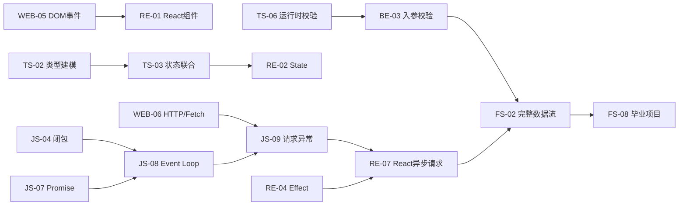

# 06 · 学习能力体系与 48 课深入设计（v0.2）

> 适用人群：有 C/C++、Qt 桌面开发经验、准备看懂和维护 AI 生成 TypeScript / React / Node.js 代码的开发者。  
> 状态：**课程内容蓝图**；并不表示 48 课正文、动画与测试已经制作完成。
> 关联：[课程总目录](04-curriculum-and-assessment.md)｜[练习与评测规格](07-exercise-design-and-grading.md)｜[项目设计](08-capstone-project-design.md)

## 1. 重新定义「学会」

仅了解概念 ≠ 能在真实项目中用好。每个核心知识点至少有四级证据：

| 能力层 | 学员必须能做什么 | 主要交互 | 通过证据 |
| --- | --- | --- | --- |
| L1 识别 | 看代码能辨认关键类型、API、运行模型 | 概念卡、判断题 | 正确指出作用与边界 |
| L2 推理 | 不运行先预测输出、调用链、状态变化 | 执行顺序题、流程动画 | 预测结果 + 给出原因 |
| L3 应用 | 根据约束补全功能、修复 bug | Monaco、局部项目练习 | 类型检查 + 正常/边界/异常测试 |
| L4 迁移 | 在不一样的项目结构中迁移知识 | 多文件缺陷任务、综合项目 | 行为回归 + 口头/文字解释修改影响 |

学习目标：关键主题（以下标有 ★）必须达到 L3；全栈综合项目要求 L4。辅助主题允许先到 L2。

### 每课内容最少由以下部分组成
1. **为什么学**：工程场景 + 真实错误。
2. **运行模型**：资源、数据、调度、对象生命周期、浏览器/Node 边界。
3. **规则与语法**：先说明保证什么、不能保证什么，再讲具体写法。
4. **C++ / Qt 类比**：明确相似处与不等价之处，杜绝错误迁移。
5. **代码追踪**：关键行逐步执行、状态快照和预期输出。
6. **错误对照**：至少一段 AI 容易写错的实现。
7. **三层练习**：预测题 → 修复/实现题 → 边界扩展。
8. **自动验证**：例子运行、静态诊断、公开测试、完整评测。
9. **复盘与迁移**：该知识在 React、Node、Electron 中会如何出现。

不得用「复制示例并运行成功」代替「完成课程」。

## 2. 必须重点讲透的 12 个知识簇

| 能力簇 | 为什么难 | 核心误解 | 必备演示或练习 | 对标项目 |
| --- | --- | --- | --- | --- |
| ★ JS 引用、闭包与 this | 与 C++ 生命周期/绑定规则不同 | 对象赋值=深拷贝；箭头函数有自己的 this | 引用关系图、回调输出预测、闭包修复 | 列表事件/回调 |
| ★ Promise + Event Loop | 微任务、宏任务、同步代码交织 | await=线程阻塞；setTimeout(0)立即执行 | 可单步任务队列动画、顺序预测 | API 加载 |
| ★ 错误传播与 fetch | HTTP 成功和 Promise fulfilled 不同 | 404 让 fetch 自动 reject | 200/404/500/断网/JSON 错误实验 | API Client |
| ★ TS 类型与运行时边界 | 编译后的类型被擦除 | as User 会校验 JSON | unknown→校验→安全类型练习 | API DTO |
| ★ 联合类型与穷尽检查 | 控制流与类型收窄交织 | 可选字段比状态联合更简单且安全 | loading/success/error 状态机与 never | 任务状态 |
| ★ 泛型与结构类型 | TS 不等同于 C++ 模板/名义类型 | 泛型 T 在运行时存在 | 泛型约束与接口兼容性实验 | 通用 Result<T> |
| ★ DOM 事件与页面生命周期 | 事件冒泡/默认行为/清理 | 子节点永远只触发自身监听器 | 事件传播轨迹、事件委托 | 动态列表 |
| ★ React State 快照 | render 与事件闭包不同步 | setState 后变量马上变了 | 连续更新与函数式 updater | 列表更新 |
| ★ React Effect 与并发请求 | 依赖、清理、严格模式重挂载 | useEffect 是通用计算容器 | 重复订阅、竞态请求、取消/忽略旧响应 | 搜索加载 |
| ★ 异步后端与异常处理 | 并发请求、数据竞争、生命周期 | try/catch 会捕获所有未 await 的异常 | 接口错误流、超时、资源清理 | Node REST API |
| ★ 数据完整性 | 前后端校验、DB 事务、并发更新 | TS 类型足以保护后端入参 | 无效数据、重复请求、回滚 | SQLite CRUD |
| ★ 调试与可靠性 | 仅靠“能跑”不能判定正确 | tsc 通过代表业务正确 | 断点、测试金字塔、回归缺陷 | 综合项目 |

**官方行为依据**：
- TS 分支收窄和 `never` 穷尽检查：[TypeScript Narrowing](https://www.typescriptlang.org/docs/handbook/2/narrowing.html)；
- React Effect 是与外部系统同步的机制，派生计算通常不需要 Effect：[React You Might Not Need an Effect](https://react.dev/learn/you-might-not-need-an-effect)，[Synchronizing with Effects](https://react.dev/learn/synchronizing-with-effects)；
- Fetch 对 HTTP 404 通常 fulfilled，需检查 Response.ok：[MDN Fetch](https://developer.mozilla.org/en-US/docs/Web/API/Window/fetch)。

## 3. 48 课逐课教学及验收蓝图

表格字段：
- **关键讲解/难点**：应包含的底层机制；
- **误区/反例**：必须在教程里有可以观察的错误；
- **必须完成的实验**：在程序中完成，不只是看答案；
- **最低验收**：至少覆盖的证明。

### S1 · Web 与浏览器（7 课）

| 课 | 关键讲解/难点 | 误区/反例 | 必须完成的实验 | 最低验收 |
| --- | --- | --- | --- | --- |
| WEB-01 | URL 解析、DNS、TCP/TLS、HTTP、DOM/CSSOM、渲染顺序 | HTML 到达即所有内容可见；混淆前端与服务端 | 拖动请求/解析/布局/绘制流程节点，DevTools 观察 | 正确指出缓存、请求与渲染阶段 |
| WEB-02 | 语义标签、表单、label、输入约束与无障碍 | 用 div 代替一切；label 未绑定 | 实现带姓名/状态的用例表单 | label 与输入关联、提交行为正确 |
| WEB-03 | 盒模型、box-sizing、定位、层叠与 overflow | width=实际占用宽度；z-index 总能盖住 | 修复溢出与定位缺陷 | 不溢出、不同视口稳定 |
| WEB-04 | Flex/Grid、min-width:0、响应式断点 | flex 子项一定会缩小 | 完成 IDE 三栏→两栏布局 | 两种宽度布局检查 |
| WEB-05 ★ | DOM 树、捕获/冒泡、委托、监听器清理 | 动态添加节点不能用事件委托 | 实现可删除的动态用例列表 | 新旧节点事件均有效、无重复响应 |
| WEB-06 ★ | HTTP 方法、CORS 概念、Fetch/DevTools、状态码 | 404 进入 catch；OPTIONS 总是业务调用 | 使用本地响应样例分析 200/404/500 | 识别状态、Headers、JSON、失败原因 |
| WEB-07 | DOM 与 CSS 维护、错误定位 | 只修视觉不检查交互 | 修复 AI 生成任务看板的布局与事件故障 | 交互和布局回归通过 |

### S2 · JavaScript 核心（9 课）

| 课 | 关键讲解/难点 | 误区/反例 | 必须完成的实验 | 最低验收 |
| --- | --- | --- | --- | --- |
| JS-01 | 基本值、对象引用、const 绑定、浅复制 | const 对象不可修改 | 比较多种对象复制方案 | 引用隔离与嵌套对象行为正确 |
| JS-02 | map/filter/reduce、不可变更新、空数组 | sort 会返回新数组而不改原数组 | 用例筛选/排序/汇总 | 原数据未意外修改，边界正确 |
| JS-03 ★ | 回调、箭头函数词法 this、方法引用 | 把方法传给回调仍保持 this | 修复失去上下文的事件处理 | this 与箭头函数实验通过 |
| JS-04 ★ | 词法环境、闭包、变量共享、内存引用 | 闭包保存的是固定值拷贝 | 修复定时器循环输出 | 多个回调输出符合预期 |
| JS-05 | prototype、class、原型查找、实例字段 | class 与 C++ 类完全等价 | 追踪对象属性查找 | own vs prototype 判断正确 |
| JS-06 | ESM、模块缓存、循环依赖、npm scripts | import 每次都会重新执行模块 | 拆分筛选、模型和输出模块 | 模块出口明确、无循环依赖 |
| JS-07 ★ | Promise 状态、then/catch/finally、错误穿透 | .then 返回值不会影响下一步 | 实现异步串联/失败恢复 | 成功与失败路径断言通过 |
| JS-08 ★ | microtask、timer、async/await、任务队列 | await 阻塞线程，timer(0)先于 microtask | 预测输出并用步骤动画排序 | 4 组不同调度题正确且能解释 |
| JS-09 ★ | fetch、AbortController、超时、HTTP/网络异常 | 状态码 404 会自动 reject | 修复 loadUser，验证 6 种返回路径 | 200/404/500/断网/坏 JSON/非法数据 |

### S3 · TypeScript（8 课）

| 课 | 关键讲解/难点 | 误区/反例 | 必须完成的实验 | 最低验收 |
| --- | --- | --- | --- | --- |
| TS-01 | TS 到 JS 的转换、strict、ESM/Node 类型环境 | TS 代码运行时存在 interface | 观察编译前后与 strict 差异 | 无隐式 any、配置正确 |
| TS-02 | interface/type、结构类型、可选/只读 | readonly 是运行时冻结 | 设计 TestCase 输入与输出模型 | 读写边界、可选类型正确 |
| TS-03 ★ | discriminated union、never 穷尽检查 | 一堆 boolean 能表示清晰状态 | 设计 idle/loading/success/error 状态机 | 添加新状态可触发编译遗漏 |
| TS-04 ★ | 泛型约束、推断、返回类型关联 | T 是运行时可查询的类型 | 通用 ApiResult<T>、按键访问函数 | 泛型关系保留且无 any |
| TS-05 | Pick/Omit/Partial/Record、DTO | Partial 到处用不会有风险 | 创建 CreateTestCase/UpdateTestCase DTO | 必选字段和禁止字段检查 |
| TS-06 ★ | any vs unknown、类型守卫、运行时校验 | as User 让外部数据安全 | 修复 JSON 数据解析与错误提示 | 非法结构不被当作有效 User |
| TS-07 | Promise<T>、moduleResolution、类型化 API | 非空断言能处理真实空值 | 构建含结果类型的 API Client | 成功/失败类型明确 |
| TS-08 ★ | 读 AI 代码、静态错误、设计债务 | tsc 通过就没有逻辑错误 | 修复 6 种缺陷并写回归测试 | 无 any 逃逸、全部行为断言通过 |

### S4 · React（9 课）

| 课 | 关键讲解/难点 | 误区/反例 | 必须完成的实验 | 最低验收 |
| --- | --- | --- | --- | --- |
| RE-01 | JSX/TSX、组件边界、Props、组合 | 组件等同 HTML 文件 | 拆分 TestCaseCard/List | Props 类型与组件组合正确 |
| RE-02 ★ | State 快照、批处理、函数式更新 | 连续 setCount(count+1) 会自增两次 | 按钮连续更新与渲染计数 | 两次递增与原值快照实验正确 |
| RE-03 | 列表 Key、条件渲染、组件身份 | 使用数组下标作 key 永远没问题 | 带本地输入状态的动态列表 | 重排后行状态不串行 |
| RE-04 ★ | Effect 清理、依赖、StrictMode、竞态 | 任意派生状态都应该放 useEffect | 修复请求竞态、订阅泄漏与多余 Effect | 请求可取消/忽略陈旧结果，清理成功 |
| RE-05 | 受控表单、校验、提交态 | 仅前端校验就足够 | 新增/编辑用例表单 | 空值、无效输入、重复提交 |
| RE-06 | 状态提升、受控组件、派生数据 | 多处复制状态更直观 | 分离 Filter/List/Toolbar | 单向数据流，筛选一致 |
| RE-07 ★ | 加载、错误、空态、重试、并发竞争 | 请求晚回来也能覆盖当前页面 | 快速切换筛选时模拟乱序响应 | 最终仅展示最新请求的结果 |
| RE-08 | Vite、Source Map、DevTools、性能 | 只靠 console.log 修复所有 bug | 查找渲染循环与布局溢出 | 断点/网络证据 + 修复验收 |
| RE-09 | React CRUD、错误反馈、组件测试 | 功能实现就不用写测试 | 测试用例看板 | CRUD 与交互回归通过 |

### S5 · Node.js（7 课）

| 课 | 关键讲解/难点 | 误区/反例 | 必须完成的实验 | 最低验收 |
| --- | --- | --- | --- | --- |
| BE-01 | Node 事件循环、异步 I/O、CPU 阻塞、进程 | Node 有事件循环就不会被阻塞 | CPU 密集任务卡顿对照实验 | 区分 CPU 与 I/O 问题 |
| BE-02 | REST、路径参数、HTTP 状态、幂等语义 | POST/PUT/PATCH 完全可替换 | GET/POST/PATCH/DELETE 例子 | 状态码和响应合同正确 |
| BE-03 ★ | 运行时入参校验、错误映射、数据边界 | TS 类型可以验证请求体 | 为创建用例接口加运行时 schema | 400/422 等错误策略一致 |
| BE-04 ★ | await 传播、全局错误边界、日志与超时 | 没有 await 的异步错误会被同步 catch | 修复漏 await/重复响应 | 错误能记录、请求只响应一次 |
| BE-05 | SQLite、唯一约束、事务、迁移 | 多个 SQL 执行会自动一起回滚 | 批量更新与回滚 | 一条失败事务不产生半完成数据 |
| BE-06 | Vitest、mock、集成测试、fixture | 用 mock 成功就等于 API 真实正确 | 设计服务与 HTTP 双层测试 | 正常/非法输入/DB 异常三类覆盖 |
| BE-07 | API 分层设计、校验、存储与测试 | 路由直接堆所有 SQL 更快维护 | 完成用例 REST API | 合约与集成测试通过 |

### S6 · 全栈 / AI 协作（8 课）

| 课 | 关键讲解/难点 | 误区/反例 | 必须完成的实验 | 最低验收 |
| --- | --- | --- | --- | --- |
| FS-01 | CORS、HTTP、前后端环境变量 | CORS 是后端业务错误 | 联调两端服务并定位 3 类请求失败 | Network/服务日志对应 |
| FS-02 | DTO→API→Service→DB→UI 数据流 | 只改前端字段即可完成需求 | 端到端新增用例字段 | 前后端、存储和测试全部更新 |
| FS-03 ★ | DevTools、断点、Source Map、异步调用栈 | 只看 UI 现象即可判断根因 | 限时定位 3 个跨层缺陷 | 提供可复现步骤与根因证据 |
| FS-04 ★ | 单测、集成、端到端、回归测试 | 100% 覆盖率等于没 bug | 构建测试矩阵与回归集 | 行为覆盖关键业务分支 |
| FS-05 | XSS、输入校验、Secrets、最小权限 | React 默认转义能解决所有 XSS 风险 | 修复危险 HTML、日志泄密与输入验证 | 3 类安全用例可复现修复 |
| FS-06 ★ | AI 需求澄清、任务拆解、最小 diff | AI 能写完就不必做验收 | 给出变更需求，先审查再修改 | 测试计划+diff+验证记录 |
| FS-07 ★ | 代码审查、风险排序、负面测试 | 修改文件少就一定没有影响 | 审查 AI 生成 PR 草案 | 识别高风险缺陷并给修复建议 |
| FS-08 ★ | 完整全栈架构、交付说明、复测 | 页面正常就算项目完成 | Mini TestPilot 毕业验收 | 各里程碑通过并能解释端到端调用链 |

## 4. 教学先修图（关键依赖，不强制锁关）

系统应显示推荐先修，不应永久锁定课程；允许有经验的学员通过诊断题跳过基础理论，但需保留关键实践验收。

## 5. 深入教学的四个质量规则

**规则 A｜输出预测题先于运行按钮。** 学员必须先在「预期输出」中选择/填写结果，提交预测后才能展开实际执行轨迹；同一题允许反复实验，记录首答与最终答。

**规则 B｜关键动画有确定性步骤。** Event Loop 演示分为调用栈、Web APIs/宿主环境、任务队列、微任务队列、console 结果；React 则分为事件 → State 更新 → render → commit → Effect；每一步要解释变化的因果。动画属于教学模拟，不得冒充真实运行时追踪。

**规则 C｜刻意错误必须可复现。** 每个误区提供至少一段错误实现、明确触发条件、观测方法和修复后的对照测试。

**规则 D｜能力迁移必须进入项目。** 每个关键难点在毕业项目里有映射。例如 JS-09→API 错误处理、TS-03→任务运行状态、RE-04→页面加载竞态、BE-05→批量事务、FS-03→跨层日志定位。

## 6. 推荐安排与难度递进

- 48 课是完整路线，不等于 48 天。关键课可安排 2–3 次练习；默认单课「概念 15 分钟、追踪 15 分钟、实现 30 分钟、复盘 10 分钟」。
- 每个阶段末增加 1 个 Checkpoint（使用本阶段现有综合课，无须额外新增课数），未通过时给出薄弱项及推荐复习课。
- 优先把 JS-08、JS-09、TS-03、TS-06、RE-02、RE-04、RE-07、BE-03、FS-03、FS-07 制成**精品示范课**。这些难点与 AI 生成 Web 代码审查关系最紧密。
- 内容生产顺序：先 JS-09 完整样板 → JS-08 事件循环 → TS-06 类型边界 → RE-04 Effect/竞态；之后复制课程模板扩展，不把模板文字误认为真实课程内容。

## 7. 必须说明的运行模型边界
- 浏览器与 Node Event Loop 细节并非完全相同；动画需标注具体宿主环境，不用单一规则覆盖所有实现。
- React StrictMode 的开发期额外渲染/Effect 调用是开发检查行为，不应误描述为生产环境必然请求两次。
- TypeScript 类型检查对运行时不可信输入无校验作用；必须使用运行时校验。
- 自动评测对行为覆盖范围有限，不能代替安全审查和人工代码质量判断。
