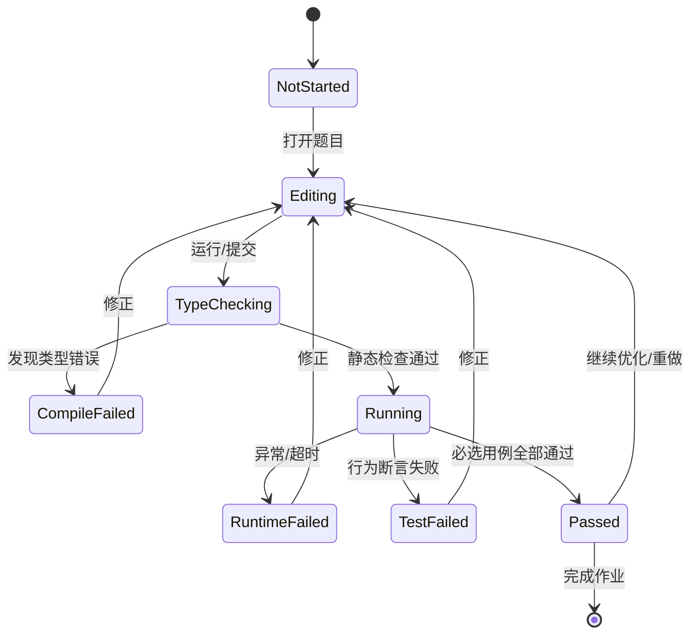

# 07 · 练习题库、作业流程与自动评测规格（v0.2）

> 目标不是“答对选择题”，而是能够读懂、预测、定位、修改、运行并解释 AI 生成的前后端代码。
> 本文是**可实现的设计契约**，不是已经上线的评分系统。
> 对应：[48 课能力地图](06-learning-objectives-and-difficulty.md)｜[架构](02-technical-architecture.md)｜[毕业项目](08-capstone-project-design.md)。

## 1. 练习系统必须支持的六种任务

| 类型 | 学员动作 | 交互组件 | 评测依据 |
| --- | --- | --- | --- |
| EX-PREDICT · 预测 | 不运行先填写输出/执行顺序 | 代码 + 顺序拖拽/填空 | 预测结果+原因 |
| EX-TRACE · 跟踪 | 逐步指出调用栈、状态、事件 | 可单步流程视图 | 步骤状态与节点定位 |
| EX-REPAIR · 排错 | 在现有有缺陷代码中最小修改 | Monaco + Problems + 测试 | 失败重现→修复→回归 |
| EX-IMPLEMENT · 实现 | 从 TODO 完成接口/函数/组件 | 文件模板 + 运行器 | 行为/边界/类型测试 |
| EX-REVIEW · 审查 | 阅读 AI 代码，指出错误、风险、修复点 | Diff + 审查注释 | 明确的风险清单与理由 |
| EX-INTEGRATE · 集成 | 修改多文件项目并在 UI 与 API 复测 | 项目工作区 + HTTP + 测试 | 端到端功能验收 |

每节课至少：**预测/解释 1 道 + 动手练习 1 道**。★ 关键课：再加 1 道反例修复与 1 组边界测试。综合课：至少一项多文件任务。

## 2. 教学反馈：四阶段而非“绿灯/红灯”

**作业任务界面**
- 任务说明：背景、完成条件、输入输出、边界、允许改哪些文件、依赖版本。
- 左：需求清单 + 提示等级 + 相关知识；中：代码编辑；右/下：Console / Type Errors / Tests / Diff / HTTP 请求。
- 点击「运行」：仅做样例执行/公开测试；点击「提交」：从稳定文件快照开始运行完整评测。
- 点击失败用例：定位失败断言、输入、预期、实际、错误堆栈和关联教程。
- 有「对比初始代码」和「还原并重做」；保存尝试次数、提示使用记录但不强制设罚分。

### 状态机（规范）



安全与失效是独立状态：RUNNER_UNAVAILABLE、INFRA_ERROR、CANCELLED 不算作学生失败，不更新能力评分。

### 分级提示（默认逐步展开）
- Hint 0：未提示，独立完成；
- Hint 1：指出知识点和错误类型，不暴露位置；
- Hint 2：指明关联函数/执行阶段和观察方法；
- Hint 3：给出修复思路或小片段，不整体覆盖代码；
- Solution：明确单独入口，完成或确认后可看参考解；查看答案不等于提交通过。

## 3. 评分与通过规则

**不建议用一个数字评价所有类型题。** 预测题主要评分「预测正确性+解释」；编码题采用门槛规则 + 分维度报告。

| 项目 | 典型权重 | 规则 |
| --- | --- | --- |
| 功能正确性 | 50% | 公开+内部行为测试；关键功能失败则不通过 |
| 异常与边界 | 25% | 非法输入、网络异常、竞态、空值 |
| 类型与静态约束 | 15% | TS strict、禁止特定危险断言、API 契约 |
| 测试与工程素质 | 10% | 回归测试/复杂度和注释，仅项目或审查题适用 |

- 普通练习：所有 `required=true` 的断言必须通过；非必须项可反馈建议但不阻断。
- 结构性限制必须在题目中提前声明，不能隐式因为格式或变量名扣分。
- 评分与运行结果关联 `exerciseId + revision + codeSnapshotHash + testBundleRevision`。
- UI 展示「运行失败/测试失败/环境失败」三类不同结论；环境错误不能计入错误次数。
- 不保证本地“隐藏测试”对用户不可读取：其意义是减少照抄，而不是考试防作弊。

## 4. 必须具备的测试矩阵

每个 EX-IMPLEMENT / EX-REPAIR 题至少考虑以下维度，并按题型裁剪：

| 维度 | 典型验证 | 失败提示 |
| --- | --- | --- |
| 正常路径 | 典型输入有预期返回 | 具体实际/预期 |
| 边界路径 | 空数组、零、缺少字段、末尾位置 | 对应边界知识 |
| 非法输入 | unknown/类型错误、非法 JSON | 解析/校验路径 |
| 错误路径 | HTTP 404/500、超时、DB 失败 | 错误类型和状态 |
| 异步/时序 | 快请求后到、取消、组件卸载 | stale data、资源清理 |
| 不可变性 | 原数组不变、状态不被直接改 | 引用与数据流 |
| 稳定性 | 重复请求、重试、恢复、幂等 | 回归触发条件 |
| 安全 | 预期字符串被转义、禁止敏感日志 | 危险输出和授权 |

JS 定时器题使用 Vitest fake timers 控制时间；网络请求用 mock/fixture 控制响应及乱序，尽量避免真实外网依赖。参考 [Vitest Timers](https://vitest.dev/guide/mocking/timers)、[Vitest Mocking](https://vitest.dev/guide/mocking.html)。

## 5. 16 道首批高价值专项练习

下表是**优先建设的练习样本**，不代表全部 48 课只需 16 道题；完整课程仍至少 1+1 练习/课。

| ID | 关联课 | 类型 | 缺陷/任务与难点 | 必须覆盖的测试 |
| --- | --- | --- | --- | --- |
| PR-01 | WEB-05 | Repair | 动态节点无法删除；修复事件绑定/委托 | 初始、新增、冒泡与解绑 |
| PR-02 | JS-02 | Implement | 列表筛选/排序，不能修改原数组 | 空、重复、稳定排序/原数组 |
| PR-03 | JS-03 | Predict+Repair | 类方法传作回调时 this 丢失 | 直接调用、解绑调用、箭头函数 |
| PR-04 | JS-04 | Predict+Repair | for/var 闭包导致回调共享变量 | 多定时器、顺序、每项独立 |
| PR-05 | JS-07 | Trace+Repair | then/catch 链异常被吞掉 | fulfilled、rejected、finally |
| PR-06 | JS-08 | Predict+Trace | 同步/Promise/timer 的执行顺序 | 4 类微/宏任务组合 |
| PR-07 | JS-09 | Repair | fetch 404、网络异常与无效 JSON | 200/404/500/断网/坏 JSON/坏结构 |
| PR-08 | TS-03 | Implement | 用联合类型建模 TaskRun，避免非法状态 | 不可达状态编译失败、穷尽检查 |
| PR-09 | TS-04 | Implement | typed result<T> 泛型返回与分支关联 | 推断、参数约束、错误分支 |
| PR-10 | TS-06 | Repair | as User 导致错误数据被放行 | 字段缺失、类型错误、空值 |
| PR-11 | RE-02 | Predict+Repair | 连续 setState 时只更新一次 | 连续操作、函数式 updater |
| PR-12 | RE-04 | Debug | 多余 Effect、重复订阅、卸载未清理 | rerender、unmount、StrictMode |
| PR-13 | RE-07 | Debug | 旧的慢请求覆盖新筛选结果 | 延迟乱序、取消/忽略旧响应 |
| PR-14 | BE-03 | Implement | 后端接受任意 JSON 导致数据污染 | 400/422、字段类型、缺失、额外字段策略 |
| PR-15 | BE-05 | Integrate | 批量更改一半成功后失败 | 事务整体回滚、重试 |
| PR-16 | FS-07 | Review+Integrate | AI PR 改字段造成前端/后端/测试不一致 | schema、API、UI、数据库与回归 |

## 6. 重点题详细规格（可拆为代码模板与评测）

### PR-06 · 事件循环执行顺序实验（JS-08）

**目标**：在宿主环境标注为「浏览器」的条件下，对同步、Promise microtask、timer task 排序；Node 环境作为对比扩展。

**初始示例**（预测前先遮挡输出）：

```ts
console.log("A");
setTimeout(() => console.log("D"), 0);
Promise.resolve().then(() => console.log("C"));
console.log("B");
```

预期：`A B C D`。  
必须解释：同步语句先执行，Promise reaction 作为 microtask 处理，timer callback 稍后调度；`0` 不意味着立刻执行。

**逐级练习**：
- L1：预测 A/B/C/D 排列；
- L2：加入 `queueMicrotask`、嵌套 `then`，追踪 microtask 队列；
- L3：加入 async 函数中 `await Promise.resolve()`，推理后半段何时恢复；
- L4：对比 Node 特定阶段，但不把浏览器规则不加限定套给 Node。

**评测**：预测答案 + 按步骤选择任务所处队列；真实运行只是验证预测；动画是教学模拟，与真实 profiler trace 分开标识。

### PR-07 · fetch 错误路径修复（JS-09）【首个精品样板】

**业务故事**：AI 生成的用户详情请求把 404 JSON 当作 User 传给页面，页面继续渲染导致错误。

**受控 API**：
```ts
type User = { id: number; name: string };
export async function loadUser(
  id: number,
  fetcher: typeof fetch = fetch
): Promise<User>;
```

允许只修改 `src/loadUser.ts`；必须保留导出名与入参类型。注入 fetcher 用于本地确定性 mock。返回类型明确；非 2xx 抛出含状态码的 `HttpError`，非法数据抛出 `DataValidationError`；网络异常原样传播或包装为可识别 `NetworkError`（正式题固定一种策略，不让测试随意变动）。

**参考缺陷**：
```ts
const response = await fetcher("/api/users/" + id);
return response.json() as Promise<User>;
```

**评测矩阵**：

| Case | 模拟条件 | 通过条件 |
| --- | --- | --- |
| C01 | 200, `{id:7,name:"Ada"}` | User 值正确 |
| C02 | 404, `{error:"not found"}` | 抛 `HttpError`，status=404 |
| C03 | 500, `{error:"server"}` | 抛 `HttpError`，status=500 |
| C04 | fetcher reject `TypeError("offline")` | 错误不被误当作 User |
| C05 | 200, body 非法 JSON | 抛可解释解析错误 |
| C06 | 200, `{id:"7",name:null}` | 抛 `DataValidationError` |
| C07 | id = 0 / 负数（若 API 限定 ID 为正整数） | 不向网络发起请求，抛参数错误 |

**可视化**：请求发起 → Promise fulfilled(Response 404) → response.ok false → HttpError；对比网络 reject 和 JSON parse reject。

**提示**：① 先定位 response.ok；② 检查 response.status；③ 使用 unknown + 类型守卫检查 `id` 和 `name`；④ 展示参考设计。完整解法不在首屏给出。

**完成证明**：所有必选 C01–C06 通过，能回答“404 为什么不一定进 catch？”。

### PR-08 · 联合类型任务状态机（TS-03）

**缺陷版本**：
```ts
type TaskRun = {
  isLoading: boolean;
  isSuccess: boolean;
  data?: string[];
  error?: string;
};
```

它容许同时 loading 与 success，或 success 但没有 data。要求改成 `{status:"idle"} | {status:"loading"} | {status:"success";data:string[]} | {status:"error";error:string}`。

**强制类型测试**：
- 正例：四状态合法构造能 typecheck；
- 反例：error 状态缺 error、success 状态缺 data 编译失败；
- `switch (state.status)` 中利用 `never` 检查穷尽；
- 增加 `cancelled` 时，未处理分支会导致编译失败；
- 不允许以 `any`、`as unknown as` 绕过约束（只在声明规则允许时使用）。

### PR-10 · 不可信 JSON 与 TS 类型擦除（TS-06）

传入 `unknown`。要求写一个真实 `isUser(value: unknown): value is User` 或 `parseUser`；提供以下数据：`null`、数组、缺少 id、字符串 id、空 name、额外属性、合法值。是否允许额外属性和空字符串由题目合约明示。

**错误模式**：直接使用 `const u = data as User` 不应满足行为测试；`tsc` 通过不意味着校验成功。与 PR-07 共用这项技能，但它们的真实业务入口不同。

### PR-12/PR-13 · React Effect、状态与竞态

**任务 A**：组件每次渲染重建订阅，缺少清理，导致重复调用。要求使用 cleanup 且监听器数量稳定。  
**任务 B**：输入查询 A→B，A 的慢响应最后返回，错误覆盖 B。要求用 AbortController 或 request sequence/ignore 标志解决；不可忽略 unmount。  
**任务 C**：把“从 Props 派生可见列表”的多余 Effect 替换为渲染时计算，避免冗余状态。

**测试**：使用受控 Promise + 测试环境模拟请求乱序；unmount 后无无效提交；在 StrictMode 开发检查下逻辑仍稳健。不要编写依赖毫秒睡眠的脆弱测试。参考 React 官方：[同步副作用](https://react.dev/learn/synchronizing-with-effects)，[不需要 Effect 的场景](https://react.dev/learn/you-might-not-need-an-effect)。

### PR-14/PR-15 · 后端校验与事务

**任务 A**：创建测试用例 API 的请求体缺少 name、status 非法、重复字段/多余属性时返回清楚的错误结构；不以 TS interface 代替校验。  
**任务 B**：批量标记用例状态，第二项触发约束错误时要全部回滚；状态不可半更新。  
**测试**：HTTP 状态/响应 JSON、数据库状态快照、失败重试与事务回滚；每次测试使用独立 DB fixture。

### PR-16 · AI 代码变更审查（FS-07）

给定需求：“用例增加 `priority` 字段，列表支持按优先级筛选”。AI 的假设实现只改前端，或未处理数据库迁移/旧数据默认值/后端入参验证。

**学员交付**：
1. 列出受影响文件和逻辑层；
2. 修改数据模型、DB 迁移、API 校验、前端表单和筛选；
3. 补正常、边界与升级兼容测试；
4. 写 150–300 字变更说明：为什么这样改、怎么验证、还有什么风险。

**验收**：实际测试通过 + 影响范围被正确覆盖；代码解释的自由文本采用人工/可选 AI 辅助评阅，不伪装成确定性单元测试。

## 7. 题目定义 Schema（待实施）

```json
{
  "schemaVersion": 1,
  "exerciseId": "PR-07",
  "revision": 1,
  "lessonId": "JS-09",
  "kind": "repair",
  "title": "修复 fetch 的 HTTP 与运行时数据错误",
  "difficulty": "core",
  "runnerId": "ts-vitest-basic",
  "workspaceTemplate": "templates/pr-07",
  "editableFiles": ["src/loadUser.ts"],
  "contracts": ["function-signature", "error-types"],
  "prerequisites": ["JS-07", "JS-08"],
  "publicTests": ["C01", "C02", "C03"],
  "requiredTestIds": ["C01", "C02", "C03", "C04", "C05", "C06"],
  "optionalTestIds": ["C07"],
  "hintIds": ["concept", "location", "strategy", "solution"],
  "limits": { "timeoutMs": 3000, "outputKb": 64 },
  "sourceOfTruth": "local-content-package"
}
```

注意：`publicTests` 与 `requiredTestIds` 的交集不是“未公开用例”保密保证；测试代码在本地产品仍可能被获取。

## 8. 完成/重做/复习规则

- `read`：阅读步骤完成；
- `practicePassed`：必选评测用例通过；
- `explained`：学员完成原因解释/预测题；
- `reviewPassed`：换一组输入或变式题独立通过；
- `mastered`：以上证据达到该课关键要求（规则化判定，不夸大成科学能力估计）。

错误题复习优先生成「相同原理、不同业务」的变式，如 fetch 用户详情→获取测试用例列表；不要单纯重复记忆相同答案。若未接入 AI，使用预制变式题即可离线完成。

## 9. 运行器/评测器必须预先确认的边界

- 使用独立评测进程，不在 Electron Main 进程 eval 学员代码。
- 使用不可变代码快照与确定性 fixtures；测试结束清理 mock/timer/端口/临时数据库。
- Vitest 测试代码不直接从用户编辑目录读取隐藏解答配置。
- 如果运行环境不可用、权限不足或依赖缺失，显示「环境不可用」，不要作为答案不正确。
- **本地 Node 子进程不构成强沙箱**，外来脚本必须由安全层单独审核；内容设计不能代替运行隔离。
